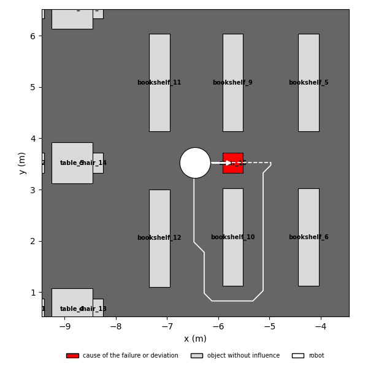

# Affordance-Based Explanations of Robot Navigation

ROS 2 package for the paper

> Amar Halilovic and Senka Krivic (2025). Affordance-Based Explanations of Robot Navigation.
> 2025 IEEE International Conference on Robotics and Automation (ICRA), Atlanta, GA, USA, pp. 13523-13529.
> DOI: [10.1109/ICRA55743.2025.11128010](https://doi.org/10.1109/ICRA55743.2025.11128010)

A robot whose path is blocked, or that has to leave its path, explains this through the affordances of the objects around it: the actions that an object allows, such as a chair that can be moved or a cabinet that can be opened.
The package generates the explanation of Algorithm 1 of the paper.
It scans the neighbourhood of the robot, reads the affordances of the objects from an ontology, finds the objects that cause the failure or deviation by replanning in perturbed environments, and returns a visual and a textual explanation.



*Visual explanation of a deviation in the library environment. `chair_16` stands between two bookshelves and is the cause (red). The dashed line is the original path, the solid line the current one.*

The textual explanations of the same situation:

| Type | Explanation |
|---|---|
| Descriptive | I deviated from my initial path because the chair in front of me blocked it. |
| Suggestive | Dear human, please move the chair in front of me so I can decrease my deviation and proceed to navigate more smoothly. |
| Counterfactual | If the chair in front of me was not there, I would not deviate from my path. |

## Results of the paper

**User study (Section VI-A).** 112 participants rated visual-textual explanations of five navigation situations on the Explanation Satisfaction Scale. The mean satisfaction score was 4.16 of 5 (SD = 0.23), and Cronbach's alpha was 0.83. The study material is not part of this repository.

**Verbalization space experiment (Section VI-B).** Ten plans of the library domain are verbalized under the combinations of the abstraction, specificity and explanation parameters. `scripts/verbalize.py` prints the average number of words per plan and the three tables behind Fig. 8. The table for abstraction and specificity:

| | General picture | Summary | Detailed narrative |
|---|---|---|---|
| A1 coordinates | 65.4 | 286.9 | 366.1 |
| A2 angles/distances | 65.4 | 128.8 | 181.0 |
| A3 right/left | 65.4 | 151.4 | 181.0 |
| A4 semantic annotations | 67.6 | 107.0 | 115.2 |

The sentences and word counts are equal to those of the script that was used for the paper. The tests check this for a sample of the averages.

## Quick start

The explanation generators need Python 3 with `numpy` and `matplotlib`, and no ROS:

```bash
git clone https://github.com/ah96/affordance_based_explanations.git
cd affordance_based_explanations
python3 scripts/aff.py          # core explanations of two library situations
python3 scripts/verbalize.py    # verbalization space experiment
python3 scripts/visualize.py    # writes visual_explanation.png
python3 -m pytest test          # needs pytest
```

With ROS 2, clone the repository into the `src` folder of a workspace and build it:

```bash
cd ~/ros2_ws
colcon build --packages-select affordance_based_explanations
source install/setup.bash
ros2 launch affordance_based_explanations explanation.launch.py
```

The explanation node waits for a robot pose, a goal and a robot state. Without a navigation stack they can be published by hand. The following reproduces the deviation shown above:

```bash
ros2 topic pub --once amcl_pose geometry_msgs/msg/PoseWithCovarianceStamped \
  "{header: {frame_id: map}, pose: {pose: {position: {x: -6.45, y: 3.52}, orientation: {w: 1.0}}}}"
ros2 topic pub --once goal_pose geometry_msgs/msg/PoseStamped \
  "{header: {frame_id: map}, pose: {position: {x: -5.0, y: 3.52}, orientation: {w: 1.0}}}"
ros2 topic pub --once robot_state std_msgs/msg/String "{data: deviation}"
ros2 service call explain std_srvs/srv/Trigger
```

## Nodes

| Command (`ros2 run affordance_based_explanations ...`) | What it does |
|---|---|
| `explanation_node.py` | Algorithm 1. Publishes the textual explanation on `textual_explanation` every `period` seconds while the robot state is a failure or a deviation, and the visual explanation as markers for RViz on `explanation_layer`. The service `explain` generates an explanation on request. |
| `qsr_server.py` | Service `qsr`: the spatial relation (front, back, left, right) for an angle. |
| `qsr_client.py <angle>` | Calls the `qsr` service. |
| `ttss.py`, `ttsc.py` | Offline speech output with `pyttsx3`, and a client that reads text from the terminal. |
| `tts_tiago.py "<text>"` | Sends a text to the speech action of a PAL Robotics robot (`tts_msgs`). |

The topics, the service and the parameters of each node are listed at the top of its file. `gtts_run.py` and `polly_run.py` are speech demos without ROS (Google TTS, AWS Polly).

## Layout

```
scripts/
  aff.py               ontology and core explanation (replanning, linear regressor)
  planner.py           grid map and A* planner used for the replanning
  qsr.py               qualitative spatial reasoning, modified single-cross calculus
  verbalize.py         textual explanations and the Verbalization Space
  visualize.py         visual explanations
  explanation_node.py  ROS 2 node for Algorithm 1
  qsr_server.py, qsr_client.py, tts_tiago.py, pyttsx3/   further ROS 2 nodes
launch/                explanation.launch.py
srv/                   QSRService.srv
ontologies/library/    ontology.csv, map_info.csv, gazebo_tags.csv
maps/library/          occupancy map of the library (map.yaml, map.pgm) and its conversion scripts
worlds/                Gazebo worlds of the library (SDF 1.7)
test/                  tests of the explanation pipeline, without ROS
figures/               the image shown above
```

**Ontology.** `ontologies/library/ontology.csv` holds 40 objects: 13 chairs, 7 tables, 16 bookshelves and 4 walls. The code reads the identifier (`gazebo_label`), the name (`label`), the centre in metres (`c_map_x`, `c_map_y`), the size in metres (`d_map_x`, `d_map_y`) and the two affordances (`movability`, `openability`). The chairs are movable. No object of the library is openable.

**Spatial relations.** The space around the robot is divided into four quadrants along its heading: front, left, back and right, each 90 degrees wide.

## How this package relates to the paper

- The implementation described in the paper ran on ROS 1, with the TIAGo robot in Gazebo, the TEB local planner and the base global planner. This package is its port to ROS 2.
- Replanning is done here with an A* planner on a grid that is built from the ontology (`map_info.csv` gives the grid, the objects give the obstacles). The package therefore runs without a navigation stack. The node takes the original path from the topic `plan` if a navigation stack publishes it.
- A planning failure and a deviation are not detected by the package. As in the paper, the detection is simulated: the robot state is sent on the topic `robot_state`.
- The example sentences of Section IV-B are reproduced by the tests. Two of them differ from the paper in one detail: the descriptive failure explanation has commas around "both in front of me", and the counterfactual one repeats the task as it is given ("fetch a book").

## Status

- The explanation generators and the verbalization space experiment are tested without ROS (`python3 -m pytest test`).
- The package was built and run on ROS 2 Lyrical: the launch file, the explanation node with its topics, service and parameters, the QSR service and its client, and `ttsc.py`.
- `ttss.py` needs `pyttsx3` and was not run. `tts_tiago.py` needs `tts_msgs` and was not run on a robot, and the default name of its action is not confirmed.
- The Gazebo worlds refer to models through `model://` paths. The models are not part of this repository, and the worlds were not run with ROS 2.

## Citation

```bibtex
@inproceedings{halilovic2025affordance,
  title     = {Affordance-Based Explanations of Robot Navigation},
  author    = {Halilovic, Amar and Krivic, Senka},
  booktitle = {2025 IEEE International Conference on Robotics and Automation (ICRA)},
  pages     = {13523--13529},
  year      = {2025},
  doi       = {10.1109/ICRA55743.2025.11128010}
}
```

## License

BSD 3-Clause, see [`LICENSE`](LICENSE). The Gazebo models that the worlds refer to are not part of this repository and keep their own licenses.
